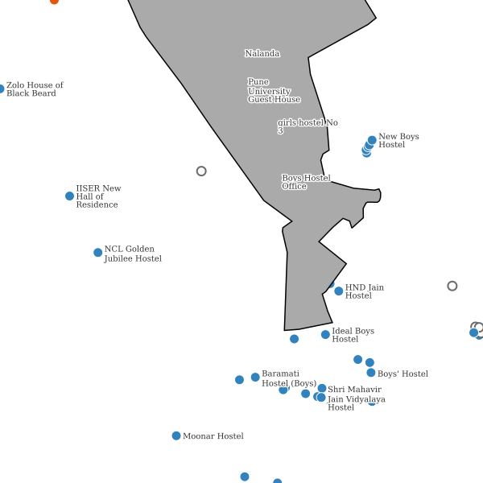

# ANSWERS

**Area:** Prabhag 11 "Bopodi – Savitribai Phule Pune University", Pune Municipal Corporation (2022 delimitation), about 7.1 km², urban city ward.
**Service type:** other — PGs and hostels. OSM tags counted: `tourism=hostel`, `tourism=guest_house`, `building=dormitory`, `amenity=dormitory`, plus any feature whose `name` contains *PG*, *Paying Guest* or *Hostel* (roads and canteens that merely carry "hostel" in the name are removed in cleaning).
**UTM zone:** 43N, EPSG:32643 (area centre 18.557° N, 73.829° E; zone = floor((73.829 + 180) / 6) + 1 = 43).
**Walking threshold:** 15 minutes = 1,200 m at 4.8 km/h (urban ward). Sensitivity run at 3.6 km/h in Q8.
**Earlier project (baseline for Q3, Q6, Q9):** PuneStay, https://github.com/Amrtyu29/punestay — straight-line search with `ST_DWithin(geom::geography, …)` on a FastAPI + PostGIS backend, Leaflet client loading one GeoJSON per request.

Every answer below gives the exact SQL or URL, the raw output (or its key lines), screenshots where asked (relative links into `docs/screenshots/`), and a short explanation.

---

## Setup checkpoint

_Screenshot of `docker compose ps` with four healthy containers and the GeoServer admin page: `docs/screenshots/setup_compose_ps.png`, `docs/screenshots/setup_geoserver_admin.png`._

## Phase 1 — From API data to your own database

### Q1. One area, four areas

**SQL:** [`sql/02_q1_area_four_ways.sql`](sql/02_q1_area_four_ways.sql) · **raw output:** [`docs/outputs/02_q1_area_four_ways.txt`](docs/outputs/02_q1_area_four_ways.txt)

```sql
SELECT ST_Area(geom)                        AS area_4326_square_degrees,
       ST_Area(geom::geography)             AS area_geography_m2,
       ST_Area(geom_utm)                    AS area_utm43n_m2,      -- geom_utm = ST_Transform(geom, 32643)
       ST_Area(ST_Transform(geom, 3857))    AS area_3857_m2,
       ST_Y(ST_Centroid(geom))              AS centre_latitude_deg
FROM area;
```

| Method | Value | Unit |
|---|---|---|
| `ST_Area(geom)` on the EPSG:4326 geometry | 0.000608292 | square **degrees** (no physical meaning) |
| `ST_Area(geom::geography)` | 7,107,832 | m² (7.1078 km²) |
| `ST_Area(geom_utm)` in UTM 43N, EPSG:32643 | 7,104,830 | m² (7.1048 km²) |
| `ST_Area(ST_Transform(geom, 3857))` Web Mercator | 7,951,391 | m² (7.9514 km²) |

Centre latitude 18.5573° N. Ratio **3857 / UTM = 1.11915**; **1 / cos²(18.5573°) = 1.11270**; they differ by 0.58 %.

*Explanation.* The 4326 number is useless because a "square degree" is a different size at every latitude. Geography and UTM agree to 0.04 % because both measure real metres (geography on the spheroid, UTM on a near-conformal plane with scale error below 0.1 % this close to the zone's 75° E meridian). Web Mercator is conformal but stretches lengths by 1/cos(φ) in both directions, so areas are inflated by 1/cos²(φ): at Pune that is +11.3 %, which is exactly what the ratio shows. The remaining 0.58 % is because the ward spans 0.046° of latitude while the formula uses one latitude, and because UTM itself is not exactly scale 1 here. **My earlier project (PuneStay)** measured distances with `ST_Distance(geom::geography, …)`, i.e. on the WGS 84 spheroid in metres, not in 3857 or UTM; those distances were straight lines, which Phase 3 revisits.

### Q2. Indexes and query plans

**SQL:** [`sql/03_q2_index_and_plans.sql`](sql/03_q2_index_and_plans.sql) · **raw plans:** [`docs/outputs/03_q2_index_and_plans.txt`](docs/outputs/03_q2_index_and_plans.txt)

Query: buildings within 500 m of each of the 19 services inside the ward (20,525 building footprints in the area + 2 km).

```sql
EXPLAIN (ANALYZE, BUFFERS)
SELECT s.service_id, s.name, count(b.building_id)
FROM services s LEFT JOIN buildings b ON ST_DWithin(s.geom_utm, b.geom_utm, 500)
WHERE s.inside_area GROUP BY s.service_id, s.name ORDER BY s.service_id;
```

| Run | Scan node on `buildings` | Rows checked by the join filter | Execution time |
|---|---|---|---|
| (a) `ST_DWithin`, **no** GiST index | `Seq Scan on buildings b` → `Materialize`, `Join Filter: st_dwithin(...)`, *Rows Removed by Join Filter: 386,694* | 19 × 20,525 = 389,975 | **431.987 ms** |
| (b) `ST_DWithin`, **with** `CREATE INDEX buildings_geom_utm_gist ON buildings USING GIST (geom_utm)` | `Index Scan using buildings_geom_utm_gist`, `Index Cond: (geom_utm && st_expand(s.geom_utm, 500))`, `Filter: st_dwithin(...)`, *Rows Removed by Filter: 50* per service | 19 × ~223 = 4,237 | **3.881 ms** |
| (c) `ST_Distance(s.geom_utm, b.geom_utm) < 500`, index present | `Seq Scan on buildings b` again, `Join Filter: (st_distance(...) < 500)`, *Rows Removed by Join Filter: 386,694* | 389,975 | **374.313 ms** |

Key plan lines (b): `Index Scan using buildings_geom_utm_gist on buildings b (actual time=0.015..0.166 rows=173 loops=19)`. Result: 3,281 service–building pairs, e.g. Colonial Hearth Mubarak has 599 buildings within 500 m, the SPPU campus hostels 92–194.

*Explanation.* Without an index PostgreSQL has no way to find "nearby" rows, so it tests every building against every service (a nested loop over 390 k pairs) and the time is dominated by 390 k exact distance computations. `ST_DWithin` is index-aware: PostGIS rewrites it as a bounding-box overlap `geom_utm && ST_Expand(point, 500)` that the GiST R-tree answers from a handful of pages, and the exact distance runs only on the ~220 candidates per service, hence **111× faster**. `ST_Distance(a, b) < 500` asks the same question but as a plain function compared to a number; the planner cannot turn a function result into an index operator, so it falls back to the sequential scan and the time goes back to the no-index level (slightly faster than (a) only because the JIT compile and buffers were warm). Lesson for the viva: write radius filters as `ST_DWithin`, never as `ST_Distance < r`.

### Q3. Data quality vs the earlier source

**SQL:** [`sql/04_q3_data_quality.sql`](sql/04_q3_data_quality.sql) · **raw output:** [`docs/outputs/04_q3_data_quality.txt`](docs/outputs/04_q3_data_quality.txt) · baseline script: [`analysis/baseline_punestay.py`](analysis/baseline_punestay.py)

```sql
SELECT count(*) AS services_in_area, count(*) FILTER (WHERE name IS NULL) AS without_name,
       round(100.0 * count(*) FILTER (WHERE name IS NULL) / count(*), 1) AS percent_without_name
FROM services WHERE inside_area;
--> 19 | 3 | 15.8
SELECT count(*) FROM services a JOIN services b
  ON a.service_id < b.service_id AND ST_DWithin(a.geom_utm, b.geom_utm, 25)
WHERE a.inside_area AND b.inside_area;
--> 0
```

| Measure | Value |
|---|---|
| Services inside Prabhag 11 after cleaning | **19** (18 hostels, 1 guest house; 10 OSM nodes, 9 building outlines) |
| Without a `name` tag | **3 of 19 = 15.8 %** (three `tourism=hostel` nodes on the SPPU campus, OSM ids 4516839589, 4516839590, 6164988185) |
| Pairs within 25 m of each other | **0** after cleaning. *Before* cleaning there was one: node `Boys Hostel - NO 9` and building way `Boys Hostel No,9`, 1 m apart, the same hostel mapped twice; the de-duplication rule in the notebook (same normalised name within 30 m) removed it. |
| Raw OSM objects matched by the tags/name search in the ward | 27, of which 5 were streets named after a hostel (`highway=*`), 1 a bus stop, 1 a hostel mess (`amenity=fast_food`), 1 the duplicate above |

**Comparison with my earlier project.** PuneStay's live API returns listings in a bounding box; filtered to the same ward polygon
(`GET https://punestay.onrender.com/listings?bbox=73.81148,18.52901,73.84413,18.57538&limit=500`, then point-in-polygon) it holds
**7 listings** inside Prabhag 11: 4 from OSM (Boys Hostel No 9, Colonial Hearth Mubarak, International Boys Hostel, International Girls Hostel) and 3 from
Overture (Godavari Boys Hostel, Stanza Living Boulder House, Stanza Living Gurudatta Apartments), all named. The new raw-OSM pipeline finds 19, i.e.
almost three times as many, because PuneStay only used `tourism=hostel` nodes plus Overture, while most SPPU hostels are mapped as *buildings* with a
hostel name and no tourism tag. Conversely, PuneStay had three commercial PGs (Stanza Living, Godavari) that are not in OSM at all: OSM under-maps
private PGs and over-represents institutional hostels. Neither source alone is complete.

**Five services checked against a second source** (official SPPU web pages, read on 2026-11-19:
[utility buildings](https://www.unipune.ac.in/university_files/utility_buildings.htm), [hostel capacity](https://www.unipune.ac.in/university_files/hostel_Capacity.htm),
[International Centre facilities](https://unipune.ac.in/dept/International%20Centre/International%20Centre%20webfile/facilities.htm)):

| # | OSM feature | Second source says | Verdict |
|---|---|---|---|
| 1 | International Boys Hostel (node 10172982148) | "The International Boys Hostel (ISH) has 96 rooms" | **correct** |
| 2 | Pune University Guest House (way 1034696718) | "It also has a University Guest House … more than 34 rooms" | **correct** (official name slightly different) |
| 3 | International Girls Hostel (node 6643174622) | the girls' international accommodation is called "International Transit House (ITH), 42 rooms and six 1BHK flats" | **correct place, outdated/colloquial name** |
| 4 | Boys Hostel No. 9 / Hostel No. 6 / Boys Hostel No. 1, 2, 7, 8 (numbered campus hostels) | capacity page: "Gents Hostel – Total Hostels 09, capacity 1689"; the pages publish no individual names | **consistent** (9 gents hostels exist; individual numbers not published, so not individually confirmed) |
| 5 | Colonial Hearth Mubarak (node 13982374992, added to OSM in 2025) | no trace on any official page or hostel directory I could find | **unverified; possibly a private hostel under another name, or closed** |

Result: 2 correct, 1 correct-but-renamed, 1 consistent-but-unconfirmed, 1 unverified; **none found misplaced**. A field check of #5 is the
one open item.

## Phase 2 — Publish your own OGC services

Setup is scripted in [`analysis/setup_geoserver.py`](analysis/setup_geoserver.py) (GeoServer REST API): workspace `punepg`, PostGIS store
(host `db`, port 5432 inside the Compose network), layers `area`, `services`, `buildings` from the views in [`sql/05_geoserver_views.sql`](sql/05_geoserver_views.sql),
style [`sld/services.sld`](sld/services.sld) (rules: unnamed / PG / hostel), and the coverage `dem` from `data/dem/dem_prabhag11.tif` (Copernicus GLO-30, clipped by
[`analysis/prepare_dem.py`](analysis/prepare_dem.py)), served by WMS and WCS (`…/wcs?service=WCS&version=2.0.1&request=DescribeCoverage&coverageId=punepg__dem`).
WMS render of DEM + ward + services: 

### Q4. The axis-order trap

**Script:** [`analysis/evidence_q4_q5.py`](analysis/evidence_q4_q5.py) · **raw log:** [`docs/outputs/q4_q5_evidence.txt`](docs/outputs/q4_q5_evidence.txt) · capabilities document: [`docs/outputs/q4_getcapabilities_130.xml`](docs/outputs/q4_getcapabilities_130.xml)

From `http://localhost:8080/geoserver/punepg/wms?service=WMS&version=1.3.0&request=GetCapabilities`, the services layer:

```xml
<BoundingBox CRS="EPSG:4326" minx="18.5124766" miny="73.7980591" maxx="18.5648147" maxy="73.85224091613597"/>
```

Note that `minx` is **18.5**: in WMS 1.3.0 the first axis of EPSG:4326 is **latitude**, exactly as the EPSG registry defines the CRS.

Two GetMap requests with the same four numbers `BBOX=18.5124766,73.7980591,18.5648147,73.85224091613597`, 600 × 600 px, layers `punepg:services,punepg:area`:

| Version | Request | Result |
|---|---|---|
| 1.1.1 | `…/wms?service=WMS&request=GetMap&version=1.1.1&srs=EPSG:4326&bbox=18.5124766,73.7980591,18.5648147,73.85224091613597&layers=punepg:services,punepg:area&width=600&height=600&format=image/png` | HTTP 200, **blank white image, 5,819 bytes** →  |
| 1.3.0 | `…/wms?service=WMS&request=GetMap&version=1.3.0&crs=EPSG:4326&bbox=18.5124766,73.7980591,18.5648147,73.85224091613597&layers=punepg:services,punepg:area&width=600&height=600&format=image/png` | HTTP 200, **map of the ward with the hostels, 45,256 bytes** →  |
| 1.1.1, box rewritten as lon/lat `73.7980591,18.5124766,73.85224091613597,18.5648147` | [`docs/screenshots/q4_getmap_111_lonlat.png`](docs/screenshots/q4_getmap_111_lonlat.png) | the same map as 1.3.0 (45,256 bytes, byte-identical) |

*Explanation.* WMS 1.1.1 (OGC 01-068r3, §6.5.5) fixes the BBOX order as `minx,miny,maxx,maxy` with x = longitude for every geographic SRS, so it reads my numbers as a box at **longitude 18.5°, latitude 73.8°**, in the Arctic Ocean north of Norway, where there is nothing to draw: a blank image. WMS 1.3.0 (OGC 06-042, §6.7.3 and Annex B) changed the rule: coordinates follow the axis order of the CRS definition, and EPSG:4326 is defined as latitude, longitude, so the same numbers are now read as lat 18.5°, lon 73.8° and the ward appears. The parameter name also changed (`SRS` → `CRS`). The fix for a 1.1.1 client is simply to swap the pairs, which gives a byte-identical image. This is the single most common interoperability bug between map clients and servers, and it is why MapLibre/Leaflet clients request `EPSG:3857` tiles (whose axis order never changed) instead.

### Q5. WFS with a filter, two formats

Filter: only **named** services **inside the ward**, expressed as CQL on the layer's attributes (`name IS NOT NULL AND inside_area = true`; `inside_area` was computed in Phase 1 with a point-in-polygon test, which is equivalent to an `INTERSECTS(geom, <ward polygon>)` spatial filter but cheaper to write in a URL).

```
http://localhost:8080/geoserver/punepg/wfs?service=WFS&version=2.0.0&request=GetFeature&typeNames=punepg:services&CQL_FILTER=name+IS+NOT+NULL+AND+inside_area+%3D+true&resultType=hits
→ numberMatched="16"
```

| Format | URL (same filter) | Size | numberMatched | First point |
|---|---|---|---|---|
| GML 3.2 | `…&outputFormat=application/gml%2Bxml;+version=3.2` ([file](docs/outputs/q5_services_named.gml)) | **16.1 KB** | 16 | `<gml:pos>18.557 73.8222</gml:pos>` with `srsName="urn:ogc:def:crs:EPSG::4326"` → **latitude, longitude** |
| GeoJSON | `…&outputFormat=application/json` ([file](docs/outputs/q5_services_named.geojson)) | **6.2 KB** | 16 (numberReturned 16) | `"coordinates": [73.8222, 18.557]` → **longitude, latitude** |

*Explanation.* 16 = 19 services inside the ward minus the 3 unnamed ones (Q3). GML 3.2 is 2.6× larger because every value is wrapped in namespaced XML elements and the geometry carries its own `srsName`. The coordinate order differs for the same reason as Q4: GML with a `urn:ogc:def:crs:EPSG::4326` CRS obeys the EPSG axis order (lat, lon), while GeoJSON (RFC 7946) fixes the order as longitude, latitude and does not even allow another CRS. A client therefore needs to know the *format* to know what the first number means, which is why the OGC API – Features standard (pg_featureserv) simply mandates GeoJSON.

## Phase 3 — Was the earlier "nearest" right?

### Q6. Straight line vs street network
_pending_

### Q7. Coverage and the MAUP
_pending_

### Q8. Who is the model for?
_pending_

## Phase 4 — Map client and performance

### Q9. Three ways to ship the same map
_pending_

## Phase 5 — Deploy it, for free

### Q10. Image size
_pending_

### Q11. Self-healing and state
_pending_

### Q12. Static vs server deployment
_pending_

## Bonus (if attempted)

### B1. Latency
### B2. Two engines, one question
### B3. Hull choice
