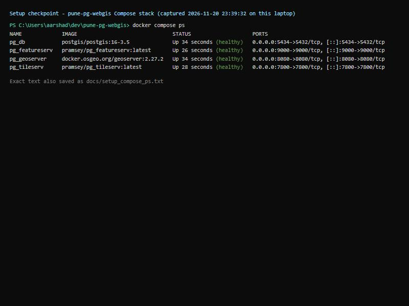
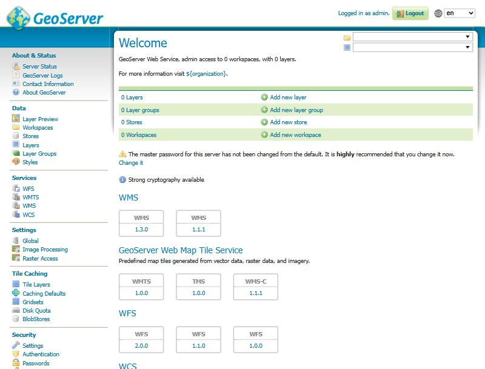
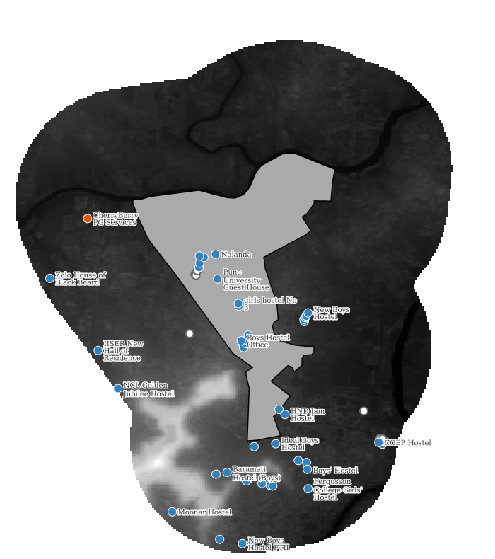
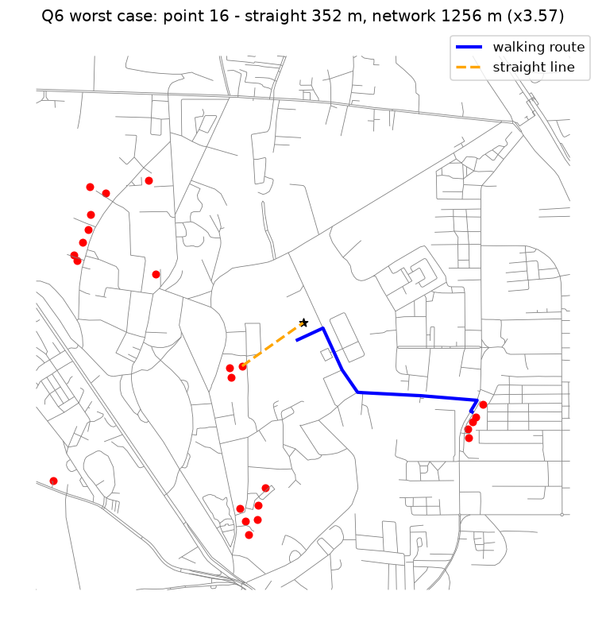
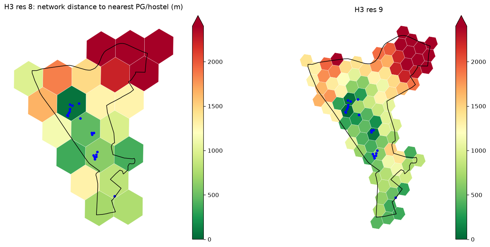
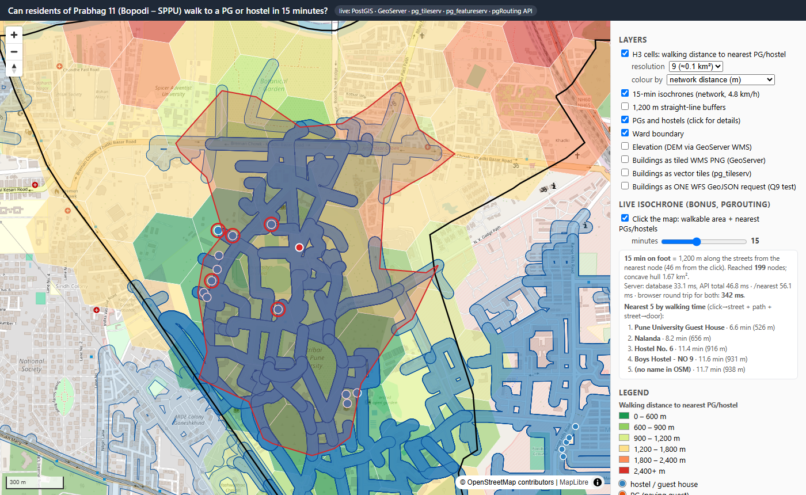
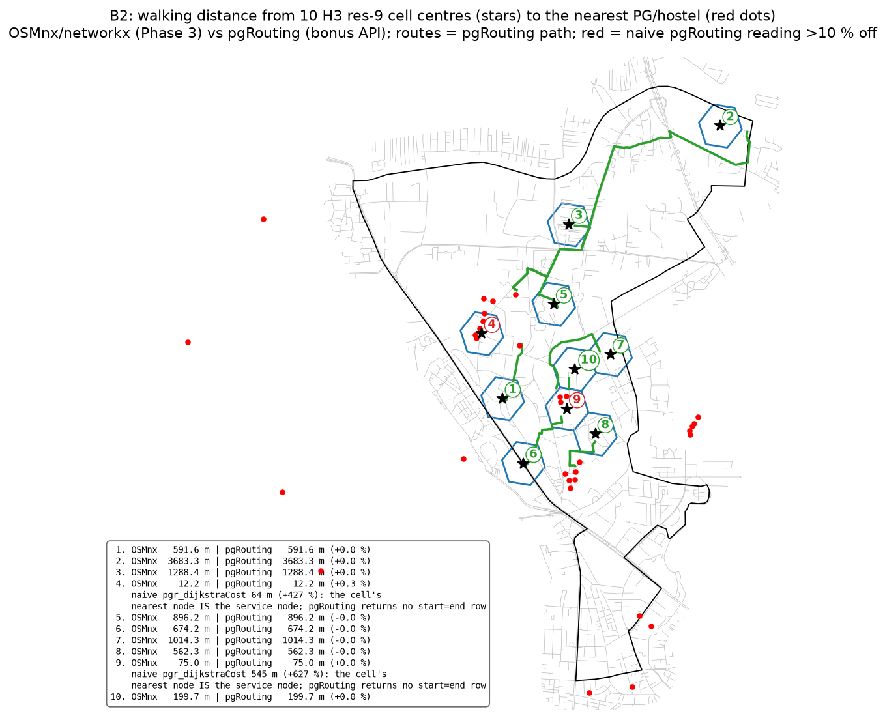
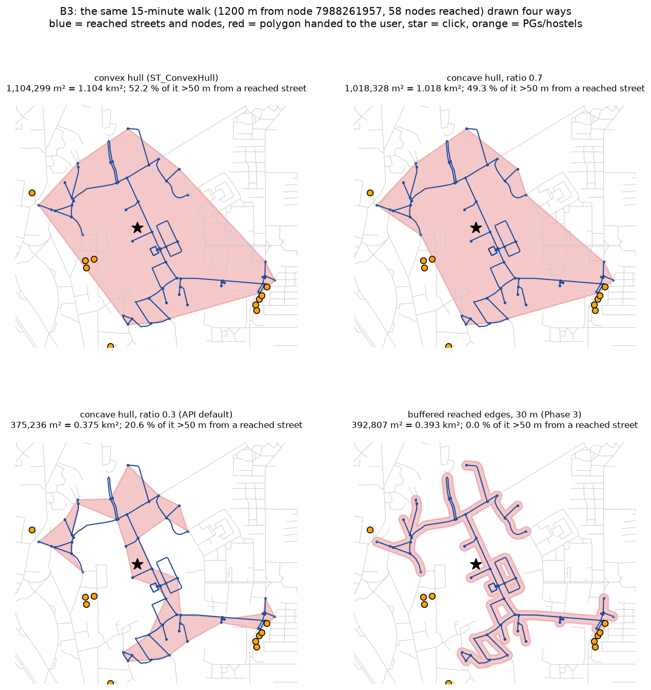

# ANSWERS

**Area:** Prabhag 11 "Bopodi – Savitribai Phule Pune University", Pune Municipal Corporation (2022 delimitation), about 7.1 km², urban city ward.
**Service type:** other — PGs and hostels. OSM tags counted: `tourism=hostel`, `tourism=guest_house`, `building=dormitory`, `amenity=dormitory`, plus any feature whose `name` contains *PG*, *Paying Guest* or *Hostel* (roads and canteens that merely carry "hostel" in the name are removed in cleaning).
**UTM zone:** 43N, EPSG:32643 (area centre 18.557° N, 73.829° E; zone = floor((73.829 + 180) / 6) + 1 = 43).
**Walking threshold:** 15 minutes = 1,200 m at 4.8 km/h (urban ward). Sensitivity run at 3.6 km/h in Q8.
**Earlier project (baseline for Q3, Q6, Q9):** PuneStay, https://github.com/Amrtyu29/punestay — straight-line search with `ST_DWithin(geom::geography, …)` on a FastAPI + PostGIS backend, Leaflet client loading one GeoJSON per request.

Every answer below gives the exact SQL or URL, the raw output (or its key lines), screenshots where asked (relative links into `docs/screenshots/`), and a short explanation.

---

## Setup checkpoint

All four containers healthy (`docker compose ps`, captured 2026-11-20; text copy in `docs/setup_compose_ps.txt`):



GeoServer admin page after login (2026-11-19):



## Phase 1 — From API data to your own database

### Q1. One area, four areas

**SQL:** [`sql/02_q1_area_four_ways.sql`](sql/02_q1_area_four_ways.sql) · **raw output:** [`docs/outputs/02_q1_area_four_ways.txt`](docs/outputs/02_q1_area_four_ways.txt)

```sql
SELECT ST_Area(geom)                        AS area_4326_square_degrees,
       ST_Area(geom::geography)             AS area_geography_m2,
       ST_Area(geom_utm)                    AS area_utm43n_m2,      -- geom_utm = ST_Transform(geom, 32643)
       ST_Area(ST_Transform(geom, 3857))    AS area_3857_m2,
       ST_Y(ST_Centroid(geom))              AS centre_latitude_deg
FROM area;
```

| Method | Value | Unit |
|---|---|---|
| `ST_Area(geom)` on the EPSG:4326 geometry | 0.000608292 | square **degrees** (no physical meaning) |
| `ST_Area(geom::geography)` | 7,107,832 | m² (7.1078 km²) |
| `ST_Area(geom_utm)` in UTM 43N, EPSG:32643 | 7,104,830 | m² (7.1048 km²) |
| `ST_Area(ST_Transform(geom, 3857))` Web Mercator | 7,951,391 | m² (7.9514 km²) |

Centre latitude 18.5573° N. Ratio **3857 / UTM = 1.11915**; **1 / cos²(18.5573°) = 1.11270**; they differ by 0.58 %.

*Explanation.* The 4326 number is useless because a "square degree" is a different size at every latitude. Geography and UTM agree to 0.04 % because both measure real metres (geography on the spheroid, UTM on a near-conformal plane with scale error below 0.1 % this close to the zone's 75° E meridian). Web Mercator is conformal but stretches lengths by 1/cos(φ) in both directions, so areas are inflated by 1/cos²(φ): at Pune that is +11.3 %, which is exactly what the ratio shows. The remaining 0.58 % is because the ward spans 0.046° of latitude while the formula uses one latitude, and because UTM itself is not exactly scale 1 here. **My earlier project (PuneStay)** measured distances with `ST_Distance(geom::geography, …)`, i.e. on the WGS 84 spheroid in metres, not in 3857 or UTM; those distances were straight lines, which Phase 3 revisits.

### Q2. Indexes and query plans

**SQL:** [`sql/03_q2_index_and_plans.sql`](sql/03_q2_index_and_plans.sql) · **raw plans:** [`docs/outputs/03_q2_index_and_plans.txt`](docs/outputs/03_q2_index_and_plans.txt)

Query: buildings within 500 m of each of the 19 services inside the ward (20,525 building footprints in the area + 2 km).

```sql
EXPLAIN (ANALYZE, BUFFERS)
SELECT s.service_id, s.name, count(b.building_id)
FROM services s LEFT JOIN buildings b ON ST_DWithin(s.geom_utm, b.geom_utm, 500)
WHERE s.inside_area GROUP BY s.service_id, s.name ORDER BY s.service_id;
```

| Run | Scan node on `buildings` | Rows checked by the join filter | Execution time |
|---|---|---|---|
| (a) `ST_DWithin`, **no** GiST index | `Seq Scan on buildings b` → `Materialize`, `Join Filter: st_dwithin(...)`, *Rows Removed by Join Filter: 386,694* | 19 × 20,525 = 389,975 | **431.987 ms** |
| (b) `ST_DWithin`, **with** `CREATE INDEX buildings_geom_utm_gist ON buildings USING GIST (geom_utm)` | `Index Scan using buildings_geom_utm_gist`, `Index Cond: (geom_utm && st_expand(s.geom_utm, 500))`, `Filter: st_dwithin(...)`, *Rows Removed by Filter: 50* per service | 19 × ~223 = 4,237 | **3.881 ms** |
| (c) `ST_Distance(s.geom_utm, b.geom_utm) < 500`, index present | `Seq Scan on buildings b` again, `Join Filter: (st_distance(...) < 500)`, *Rows Removed by Join Filter: 386,694* | 389,975 | **374.313 ms** |

Key plan lines (b): `Index Scan using buildings_geom_utm_gist on buildings b (actual time=0.015..0.166 rows=173 loops=19)`. Result: 3,281 service–building pairs, e.g. Colonial Hearth Mubarak has 599 buildings within 500 m, the SPPU campus hostels 92–194.

*Explanation.* Without an index PostgreSQL has no way to find "nearby" rows, so it tests every building against every service (a nested loop over 390 k pairs) and the time is dominated by 390 k exact distance computations. `ST_DWithin` is index-aware: PostGIS rewrites it as a bounding-box overlap `geom_utm && ST_Expand(point, 500)` that the GiST R-tree answers from a handful of pages, and the exact distance runs only on the ~220 candidates per service, hence **111× faster**. `ST_Distance(a, b) < 500` asks the same question but as a plain function compared to a number; the planner cannot turn a function result into an index operator, so it falls back to the sequential scan and the time goes back to the no-index level (slightly faster than (a) only because the JIT compile and buffers were warm). Lesson for the viva: write radius filters as `ST_DWithin`, never as `ST_Distance < r`.

### Q3. Data quality vs the earlier source

**SQL:** [`sql/04_q3_data_quality.sql`](sql/04_q3_data_quality.sql) · **raw output:** [`docs/outputs/04_q3_data_quality.txt`](docs/outputs/04_q3_data_quality.txt) · baseline script: [`analysis/baseline_punestay.py`](analysis/baseline_punestay.py)

```sql
SELECT count(*) AS services_in_area, count(*) FILTER (WHERE name IS NULL) AS without_name,
       round(100.0 * count(*) FILTER (WHERE name IS NULL) / count(*), 1) AS percent_without_name
FROM services WHERE inside_area;
--> 19 | 3 | 15.8
SELECT count(*) FROM services a JOIN services b
  ON a.service_id < b.service_id AND ST_DWithin(a.geom_utm, b.geom_utm, 25)
WHERE a.inside_area AND b.inside_area;
--> 0
```

| Measure | Value |
|---|---|
| Services inside Prabhag 11 after cleaning | **19** (18 hostels, 1 guest house; 10 OSM nodes, 9 building outlines) |
| Without a `name` tag | **3 of 19 = 15.8 %** (three `tourism=hostel` nodes on the SPPU campus, OSM ids 4516839589, 4516839590, 6164988185) |
| Pairs within 25 m of each other | **0** after cleaning. *Before* cleaning there was one: node `Boys Hostel - NO 9` and building way `Boys Hostel No,9`, 1 m apart, the same hostel mapped twice; the de-duplication rule in the notebook (same normalised name within 30 m) removed it. |
| Raw OSM objects matched by the tags/name search in the ward | 27, of which 5 were streets named after a hostel (`highway=*`), 1 a bus stop, 1 a hostel mess (`amenity=fast_food`), 1 the duplicate above |

**Comparison with my earlier project.** PuneStay's live API returns listings in a bounding box; filtered to the same ward polygon
(`GET https://punestay.onrender.com/listings?bbox=73.81148,18.52901,73.84413,18.57538&limit=500`, then point-in-polygon) it holds
**7 listings** inside Prabhag 11: 4 from OSM (Boys Hostel No 9, Colonial Hearth Mubarak, International Boys Hostel, International Girls Hostel) and 3 from
Overture (Godavari Boys Hostel, Stanza Living Boulder House, Stanza Living Gurudatta Apartments), all named. The new raw-OSM pipeline finds 19, i.e.
almost three times as many, because PuneStay only used `tourism=hostel` nodes plus Overture, while most SPPU hostels are mapped as *buildings* with a
hostel name and no tourism tag. Conversely, PuneStay had three commercial PGs (Stanza Living, Godavari) that are not in OSM at all: OSM under-maps
private PGs and over-represents institutional hostels. Neither source alone is complete.

**Five services checked against a second source** (official SPPU web pages, read on 2026-11-19:
[utility buildings](https://www.unipune.ac.in/university_files/utility_buildings.htm), [hostel capacity](https://www.unipune.ac.in/university_files/hostel_Capacity.htm),
[International Centre facilities](https://unipune.ac.in/dept/International%20Centre/International%20Centre%20webfile/facilities.htm)):

| # | OSM feature | Second source says | Verdict |
|---|---|---|---|
| 1 | International Boys Hostel (node 10172982148) | "The International Boys Hostel (ISH) has 96 rooms" | **correct** |
| 2 | Pune University Guest House (way 1034696718) | "It also has a University Guest House … more than 34 rooms" | **correct** (official name slightly different) |
| 3 | International Girls Hostel (node 6643174622) | the girls' international accommodation is called "International Transit House (ITH), 42 rooms and six 1BHK flats" | **correct place, outdated/colloquial name** |
| 4 | Boys Hostel No. 9 / Hostel No. 6 / Boys Hostel No. 1, 2, 7, 8 (numbered campus hostels) | capacity page: "Gents Hostel – Total Hostels 09, capacity 1689"; the pages publish no individual names | **consistent** (9 gents hostels exist; individual numbers not published, so not individually confirmed) |
| 5 | Colonial Hearth Mubarak (node 13982374992, added to OSM in 2025) | no trace on any official page or hostel directory I could find | **unverified; possibly a private hostel under another name, or closed** |

Result: 2 correct, 1 correct-but-renamed, 1 consistent-but-unconfirmed, 1 unverified; **none found misplaced**. A field check of #5 is the
one open item.

## Phase 2 — Publish your own OGC services

Setup is scripted in [`analysis/setup_geoserver.py`](analysis/setup_geoserver.py) (GeoServer REST API): workspace `punepg`, PostGIS store
(host `db`, port 5432 inside the Compose network), layers `area`, `services`, `buildings` from the views in [`sql/05_geoserver_views.sql`](sql/05_geoserver_views.sql),
style [`sld/services.sld`](sld/services.sld) (rules: unnamed / PG / hostel), and the coverage `dem` from `data/dem/dem_prabhag11.tif` (Copernicus GLO-30, clipped by
[`analysis/prepare_dem.py`](analysis/prepare_dem.py)), served by WMS and WCS (`…/wcs?service=WCS&version=2.0.1&request=DescribeCoverage&coverageId=punepg__dem`).
WMS render of DEM + ward + services: 

### Q4. The axis-order trap

**Script:** [`analysis/evidence_q4_q5.py`](analysis/evidence_q4_q5.py) · **raw log:** [`docs/outputs/q4_q5_evidence.txt`](docs/outputs/q4_q5_evidence.txt) · capabilities document: [`docs/outputs/q4_getcapabilities_130.xml`](docs/outputs/q4_getcapabilities_130.xml)

From `http://localhost:8080/geoserver/punepg/wms?service=WMS&version=1.3.0&request=GetCapabilities`, the services layer:

```xml
<BoundingBox CRS="EPSG:4326" minx="18.5124766" miny="73.7980591" maxx="18.5648147" maxy="73.85224091613597"/>
```

Note that `minx` is **18.5**: in WMS 1.3.0 the first axis of EPSG:4326 is **latitude**, exactly as the EPSG registry defines the CRS.

Two GetMap requests with the same four numbers `BBOX=18.5124766,73.7980591,18.5648147,73.85224091613597`, 600 × 600 px, layers `punepg:services,punepg:area`:

| Version | Request | Result |
|---|---|---|
| 1.1.1 | `…/wms?service=WMS&request=GetMap&version=1.1.1&srs=EPSG:4326&bbox=18.5124766,73.7980591,18.5648147,73.85224091613597&layers=punepg:services,punepg:area&width=600&height=600&format=image/png` | HTTP 200, **blank white image, 5,819 bytes** →  |
| 1.3.0 | `…/wms?service=WMS&request=GetMap&version=1.3.0&crs=EPSG:4326&bbox=18.5124766,73.7980591,18.5648147,73.85224091613597&layers=punepg:services,punepg:area&width=600&height=600&format=image/png` | HTTP 200, **map of the ward with the hostels, 45,256 bytes** →  |
| 1.1.1, box rewritten as lon/lat `73.7980591,18.5124766,73.85224091613597,18.5648147` | [`docs/screenshots/q4_getmap_111_lonlat.png`](docs/screenshots/q4_getmap_111_lonlat.png) | the same map as 1.3.0 (45,256 bytes, byte-identical) |

*Explanation.* WMS 1.1.1 (OGC 01-068r3, §6.5.5) fixes the BBOX order as `minx,miny,maxx,maxy` with x = longitude for every geographic SRS, so it reads my numbers as a box at **longitude 18.5°, latitude 73.8°**, in the Arctic Ocean north of Norway, where there is nothing to draw: a blank image. WMS 1.3.0 (OGC 06-042, §6.7.3 and Annex B) changed the rule: coordinates follow the axis order of the CRS definition, and EPSG:4326 is defined as latitude, longitude, so the same numbers are now read as lat 18.5°, lon 73.8° and the ward appears. The parameter name also changed (`SRS` → `CRS`). The fix for a 1.1.1 client is simply to swap the pairs, which gives a byte-identical image. This is the single most common interoperability bug between map clients and servers, and it is why MapLibre/Leaflet clients request `EPSG:3857` tiles (whose axis order never changed) instead.

### Q5. WFS with a filter, two formats

Filter: only **named** services **inside the ward**, expressed as CQL on the layer's attributes (`name IS NOT NULL AND inside_area = true`; `inside_area` was computed in Phase 1 with a point-in-polygon test, which is equivalent to an `INTERSECTS(geom, <ward polygon>)` spatial filter but cheaper to write in a URL).

```
http://localhost:8080/geoserver/punepg/wfs?service=WFS&version=2.0.0&request=GetFeature&typeNames=punepg:services&CQL_FILTER=name+IS+NOT+NULL+AND+inside_area+%3D+true&resultType=hits
→ numberMatched="16"
```

| Format | URL (same filter) | Size | numberMatched | First point |
|---|---|---|---|---|
| GML 3.2 | `…&outputFormat=application/gml%2Bxml;+version=3.2` ([file](docs/outputs/q5_services_named.gml)) | **16.1 KB** | 16 | `<gml:pos>18.557 73.8222</gml:pos>` with `srsName="urn:ogc:def:crs:EPSG::4326"` → **latitude, longitude** |
| GeoJSON | `…&outputFormat=application/json` ([file](docs/outputs/q5_services_named.geojson)) | **6.2 KB** | 16 (numberReturned 16) | `"coordinates": [73.8222, 18.557]` → **longitude, latitude** |

*Explanation.* 16 = 19 services inside the ward minus the 3 unnamed ones (Q3). GML 3.2 is 2.6× larger because every value is wrapped in namespaced XML elements and the geometry carries its own `srsName`. The coordinate order differs for the same reason as Q4: GML with a `urn:ogc:def:crs:EPSG::4326` CRS obeys the EPSG axis order (lat, lon), while GeoJSON (RFC 7946) fixes the order as longitude, latitude and does not even allow another CRS. A client therefore needs to know the *format* to know what the first number means, which is why the OGC API – Features standard (pg_featureserv) simply mandates GeoJSON.

## Phase 3 — Was the earlier "nearest" right?

All Phase 3 numbers come from [`analysis/02_isochrones_h3.ipynb`](analysis/02_isochrones_h3.ipynb) (run top to bottom; results also in
[`docs/outputs/phase3_results.json`](docs/outputs/phase3_results.json)). Walking graph: OSMnx `network_type="walk"`, area + 2 km, 6,645 nodes / 8,545 undirected edges,
projected to UTM 43N. Speed 4.8 km/h → **1,200 m in 15 min**; destinations = all 54 PGs/hostels in the ward **and** the 2 km margin (19 inside).
Isochrone = all street segments reachable within 1,200 m of the service's nearest node (`networkx.ego_graph`, `distance="length"`), buffered 30 m.
Population = WorldPop 2020 constrained 100 m, **98,234 people** in the ward (685 populated pixels), every pixel assigned to exactly one H3 cell.

### Q6. Straight line vs street network

30 random points inside the ward (seed 20261119; table `q6_random_points` in PostGIS). For each: nearest service by straight line (UTM Euclidean,
what PuneStay's `ST_DWithin(geography)` search effectively ranked by) and by walking network (Dijkstra from the point's nearest node to every service node,
plus the two snap distances).

| Measure | Result |
|---|---|
| Nearest service is a **different** one by network than by straight line | **13 of 30 points (43 %)** |
| Ratio network / straight-line distance | **median 1.55, maximum 4.57** |
| Largest ratio overall | point 21: 46 m straight, 209 m walking (×4.57), a hostel just across a campus fence |
| Worst case among points ≥ 300 m from a service (the one mapped) | **point 16** (18.55306 N, 73.83177 E): straight line 352 m to *L 10* hostel (#15), walking 1,256 m to a different hostel (#26) → **×3.57** |
| Largest absolute detour | point 23: 2,391 m straight, 3,583 m walking (+1,192 m) |



*Barrier.* Point 16 lies just outside the eastern boundary wall of the Savitribai Phule Pune University campus. The straight line (orange) cuts through the
wall to the *L 10* hostel block; on foot (blue) one has to go round the campus perimeter to a gate, so the nearest hostel on the network is a different one.
**Gated campus walls** are the dominant barrier in this ward; the SPPU campus, IUCAA, the NCL and the Khadki cantonment all have few gates. The median
detour factor of 1.55 is well above the 1.2 to 1.3 typical of an open street grid, and 43 % of "nearest" answers from my earlier project would have
pointed at the wrong hostel.

### Q7. Coverage and the MAUP

Share of the ward's population **beyond 1,200 m** of the nearest PG/hostel, by network and by straight-line buffer, at four levels of aggregation
(a unit is "covered" when its centre is within the threshold; at pixel level each 100 m pixel judges itself):

| Unit of analysis | units | % population beyond 1,200 m, **network** | % beyond 1,200 m, **buffer** |
|---|---|---|---|
| WorldPop pixel, 100 m (reference) | 685 | **54.3 %** | 28.8 % |
| H3 resolution 9 (≈0.105 km²) | 95 | 53.4 % | 27.6 % |
| H3 resolution 8 (≈0.74 km²) | 22 | 56.4 % | 29.8 % |
| Ward as one unit (its centroid) | 1 | **0 %** | 0 % |

Area covered inside the ward: isochrones 32.4 %, buffers 80.2 % ([map](docs/screenshots/q7_isochrone_vs_buffer.png)).
Worst-served populated res-9 cell (≥ 50 people): **`89608851867ffff`** (127 people, centre 18.57348 N 73.84441 E): straight line 2,609 m, **walking 5,198 m**
to *Nalanda* hostel. The route (`analysis/explain_worst_cell.py`) goes over **New Harris Bridge** across the Mula river, along the Old Pune–Mumbai Highway and
into the campus by the IUCAA back road: the river is crossable only at that bridge. Next worst: `89608851b93ffff` (1,040 people, 3,683 m) in the same
Bopodi pocket north of the river.



*Does the conclusion change with the unit?* The **method** matters far more than the unit: buffers say 29 % of residents are left out, the street network says
54 %, almost double, because the campus walls and the Mula river make straight-line reach meaningless here. Across H3 8 and 9 and the pixel level the
network figure only moves between 53 and 56 %, so hexagons of either size give an honest answer; but the ward as a single unit says **nobody** is left out
(its centroid sits 900 m from a campus hostel), which is the modifiable areal unit problem at its most extreme: the same 98,234 people, the same hostels,
and the answer flips from "half excluded" to "all served" purely by choosing a coarse zone. Resolution 8 also hides *where*: its 22 cells smear the
Bopodi pocket north of the river into cells that straddle the river, while resolution 9 isolates the 5 worst cells holding about 3,500 people.

### Q8. Who is the model for?

Same network, walking speed **3.6 km/h** (elderly walkers): 15 min = **900 m**.

| Unit | % population covered @ 4.8 km/h | % covered @ 3.6 km/h | percentage points lost |
|---|---|---|---|
| WorldPop pixel, 100 m | 45.7 % | 33.2 % | **−12.4 pp** |
| H3 res 9 | 46.6 % | 38.7 % | −7.8 pp |
| H3 res 8 | 43.6 % | 38.7 % | −4.9 pp |

At pixel level **12.4 percentage points** of the population, about **12,200 people**, drop out of 15-minute reach when the model is built for a slower walker.
At res 9, 11 cells holding 7,686 people flip from covered to not covered; they form a ring 900–1,200 m along the streets from the campus hostels: the
Ganeshkhind Road / Aundh Road frontage west of the campus and the southern tip of the ward near Shivajinagar (dark-green core stays, the light-green
fringe disappears; see the `covered_net_slow` column of `hex_r9` and the "isochrone 900 m" layer in the client). The lesson: a "15-minute" claim is really
a claim about *who* walks; the healthy-adult default overstates access for the elderly by a quarter of the covered population in this ward.

## Phase 4 — Map client and performance

### Q9. Three ways to ship the same map

Client: [`client/`](client/) (MapLibre GL JS). The three building modes are the last three checkboxes of the layer switcher.
Measurement: [`analysis/measure_q9.py`](analysis/measure_q9.py) drives a headless Chromium with the cache disabled (the DevTools
"Disable cache" setting, via CDP `Network.setCacheDisabled`), opens the client at the given zoom (centre 73.829 E 18.552 N, 1280 × 800 px),
ticks one checkbox and records every response of that layer until MapLibre is idle; raw numbers in
[`docs/outputs/q9_measurements.json`](docs/outputs/q9_measurements.json). "KB" = response bytes received; "time" = tick → last response.

| Zoom | (a) tiled WMS PNG, GeoServer `GetMap` 256 px | (b) one WFS 2.0 GeoJSON `GetFeature` | (c) MVT from pg_tileserv `/public.buildings/{z}/{x}/{y}.pbf` |
|---|---|---|---|
| **12** | 16 requests · **193 KB** · 1.3 s | 1 request · **8,435 KB** · 2.7 s | 4 requests · **1,450 KB** · 0.9 s |
| **14** | 16 requests · **711 KB** · 1.2 s | 1 request · **8,416 KB** · 5.1 s | 6 requests · **855 KB** · 1.3 s |
| **16** | 20 requests · **226 KB** · 1.0 s | 1 request · **8,428 KB** · 2.7 s | 6 requests · **25 KB** · 0.5 s |

(20,525 footprints in the area + 2 km. The WFS answer is the same 8.4 MB whatever the zoom; MapLibre then has to parse and index all of it in the
browser, which is the extra 2–5 s. Times vary ±1 s between runs because all services share one laptop.)

*Which breaks first as the area grows.* **(b) the single GeoJSON**: its cost is proportional to the *whole dataset*, not to what is on screen, so a
city of two million buildings would mean an 800 MB download and a frozen tab, while the view at zoom 16 needs only a few hundred polygons.
**(c) MVT** scales best: at zoom 16 the six tiles for the view weigh 25 KB, and at low zooms pg_tileserv already clips to the tile (1.4 MB at
zoom 12 because every footprint in the area falls into four tiles; for a whole city one would add `--drop-densest`-style generalisation or a
min-zoom). **(a) tiled WMS** also scales with the view, but every tile is a server-side render: 16–20 PNG requests per screen, nothing clickable,
and a new render for every style change. **My earlier project (PuneStay)** loaded its data the (b) way: one `GET /listings?bbox=…` returning all
matching listings as GeoJSON (capped at 500 rows) and one GeoJSON per nearby-services search; with 520 listings that is a few hundred KB and fine,
but at city scale with every building or every POI it would behave exactly like column (b): one giant response, then the browser chokes.

## Phase 5 — Deploy it, for free

### Q10. Image size

Two builds of the same client ([`client/Dockerfile`](client/Dockerfile) multi-stage, [`client/Dockerfile.single-stage`](client/Dockerfile.single-stage)):

```powershell
docker build -t punepg-client:local client/
docker build -f client/Dockerfile.single-stage -t punepg-client:single client/
docker images | findstr punepg
```

| Image | Base | Size |
|---|---|---|
| `punepg-client:single` | one stage, `node:20` (Debian), serves with `npx serve` | **1.7 GB** |
| `punepg-client:local` | stage 1 `node:20` builder → stage 2 `nginx:1.27-alpine` | **83.8 MB** (20× smaller) |

`docker history punepg-client:local` (full output in [`docs/outputs/q10_history_multistage.txt`](docs/outputs/q10_history_multistage.txt); single-stage in [`q10_history_singlestage.txt`](docs/outputs/q10_history_singlestage.txt)):

```
CREATED BY                                      SIZE
EXPOSE [80/tcp]                                 0B
COPY /build/site /usr/share/nginx/html          8.81MB     <- my site: HTML/JS/CSS + vendored MapLibre (0.8 MB) + GeoJSON data (7 MB)
COPY nginx.conf /etc/nginx/conf.d/default.conf  20.5kB
RUN /bin/sh -c set -x && apkArch=...            38.7MB     <- nginx binary + modules (largest layer)
...
RUN /bin/sh -c set -x && addgroup -g 101...     5.36MB     <- nginx user, entrypoint scripts
ADD alpine-minirootfs-3.21.3-x86_64.tar.gz /    8.5MB      <- Alpine base
```

*Explanation.* In the multi-stage image the largest layer is the **nginx install (38.7 MB)**, followed by my site content (8.8 MB, mostly the
exported GeoJSON) and the Alpine root file system (8.5 MB); nothing from the build stage survives except the copied `/build/site` folder.
The single-stage image keeps the whole `node:20` base (Debian + Node + npm + Python/gcc build tools, about 1.1 GB) plus `node_modules`
for MapLibre and `serve`, none of which the browser ever needs, so it is 1.7 GB. Smaller images pull faster into kind, start faster and have
far fewer packages to patch; that is what the `COPY --from=builder` line buys.

### Q11. Self-healing and state

Cluster: `kind create cluster --name punepg` (Kubernetes v1.37.0, one node); manifests in [`k8s/`](k8s/) applied with `kubectl apply -f k8s/`
(see [`k8s/README.md`](k8s/README.md)). Experiment script: [`k8s/q11_selfheal.ps1`](k8s/q11_selfheal.ps1): it writes a marker row,
runs `kubectl get pods -w` with a wall-clock stamp on every line, deletes the pod, waits for Ready and reads the marker again.
Full logs: [`docs/outputs/q11_pvc.txt`](docs/outputs/q11_pvc.txt), [`docs/outputs/q11_emptydir.txt`](docs/outputs/q11_emptydir.txt).

**Run 1: StatefulSet with a PersistentVolumeClaim (`data-postgis-0`, 2 Gi, bound)**

```
15:48:18.699  rows in q11_marker before deletion: 1 rows, first written 2026-11-19 10:18:18
15:48:21.723  kubectl delete pod postgis-0
15:48:22.516  postgis-0   1/1   Terminating
15:48:23.829  postgis-0   0/1   Pending             <- new pod object (uid 1968f08a… -> d7dac2a2…)
15:48:23.856  postgis-0   0/1   ContainerCreating
15:48:24.412  postgis-0   0/1   Running
15:48:35.093  postgis-0   1/1   Running             <- readiness probe (pg_isready) passes
15:48:35.182  postgis-0 Ready again after 13.4 s
15:48:43.502  rows in q11_marker after recreation: 1 rows, first written 2026-11-19 10:18:18   <- DATA SURVIVED
```

**Run 2: same StatefulSet with `emptyDir: {}` instead of the PVC** ([`k8s/experiments/postgis-emptydir.yaml`](k8s/experiments/postgis-emptydir.yaml))

```
15:48:58.555  rows in q11_marker before deletion: 1 rows
15:49:00.903  kubectl delete pod postgis-0
15:49:02.085  postgis-0   0/1   Pending
15:49:02.640  postgis-0   0/1   Running
15:49:13.114  postgis-0   1/1   Running
15:49:13.122  postgis-0 Ready again after 12.2 s
15:49:18.618  rows in q11_marker after recreation: ERROR:  relation "q11_marker" does not exist   <- EVERYTHING LOST
```

| | PVC | emptyDir |
|---|---|---|
| Replacement pod Running | 2.7 s after delete | 1.7 s |
| Ready (PostgreSQL accepting connections) | **13.4 s** | **12.2 s** |
| Marker table after restart | present, same timestamp | gone; PostgreSQL re-ran `initdb` into an empty directory (the whole database, users and PostGIS extension had to be recreated from the image defaults) |

*Explanation.* Self-healing is the StatefulSet controller's reconciliation loop: the moment the pod object disappears the controller sees
"desired 1, observed 0" and creates `postgis-0` again, and the only real delay is PostgreSQL's own start-up until `pg_isready` succeeds. What
survives depends purely on *where the files were*. With a PVC the volume is a separate Kubernetes object; the new pod mounts the same
`data-postgis-0` claim and finds its data directory intact. An `emptyDir` is created with the pod and deleted with it, so the new pod starts
with an empty disk and the entrypoint initialises a brand-new cluster: the database is "healthy" and completely empty. A database therefore
needs a **StatefulSet, not a Deployment**: the StatefulSet gives the pod a stable name (`postgis-0`), a stable DNS entry through the headless
Service, and a `volumeClaimTemplate` that binds exactly one PVC to exactly that pod, re-attached on every restart. A Deployment treats its pods
as interchangeable copies with random names: it could schedule two replicas at once during a rollout, both writing the same files, and it has no
notion of "the volume that belongs to replica 0".

To reach the client: `kubectl -n punepg port-forward svc/client 8089:80` → http://localhost:8089 (nginx `punepg-client:local` loaded into kind
with `kind load docker-image`).

### Q12. Static vs server deployment

Public URL: **https://amrtyu29.github.io/pune-pg-webgis/** (built and deployed by [`.github/workflows/deploy-pages.yml`](.github/workflows/deploy-pages.yml):
tippecanoe → `punepg.pmtiles` (3,687,883 bytes, layers `hex_r8`, `hex_r9`, `buildings`) → GitHub Pages).
Measured with [`analysis/measure_q12.py`](analysis/measure_q12.py) (headless Chromium, cache disabled, zoom 14, same centre as Q9;
raw log [`docs/outputs/q12_pages_requests.json`](docs/outputs/q12_pages_requests.json), screenshot [`docs/screenshots/q12_pages_zoom14.png`](docs/screenshots/q12_pages_zoom14.png)).

One PMTiles request and its response:

```
GET https://amrtyu29.github.io/pune-pg-webgis/data/punepg.pmtiles
Range: bytes=1792576-1830936
→ HTTP 206 Partial Content
Content-Range: bytes 1792576-1830936/3687883   (38,361 bytes)
```

| At zoom 14, Pages site | Requests | KB |
|---|---|---|
| PMTiles (header 16 KB + directory + hex tiles for the view) | 7, all **HTTP 206** | **378.8 KB** |
| GeoJSON fetches (services, isochrones, buffers, area) | 21 | 1,161 KB |
| JS + CSS (MapLibre, PMTiles, app) | 7 | 1,276 KB |
| OSM basemap tiles | 16 | 417 KB |
| **Whole view** | **36** | **2,819 KB** |

*Comparison with Q9.* The hex layer at zoom 14 cost 7 range requests / 379 KB from a static file, in the same order as pg_tileserv's 6 MVT
requests / 855 KB for the buildings at that zoom; the first request (`bytes=0-16383`) is the PMTiles header, the next ones the directory, and only
then the tile bytes, so a static archive pays a small fixed overhead but after that behaves exactly like a tile server, with no process running.
**Two things the server stack can do that the static site cannot:** (1) answer *queries*: a WFS/CQL filter, an OGC API `bbox=` request, or a new
isochrone for a point the user clicks, because PostGIS is there to compute; (2) serve *live* data and rasters: any table update is visible on the
next tile, and the DEM comes through WMS/WCS, whereas the static site froze the data at build time and has no raster service at all (its DEM toggle
is disabled). **One advantage of the static site:** it costs nothing and has nothing to keep alive: no database, GeoServer or tile server to patch,
restart or scale; GitHub's CDN serves byte ranges to any number of viewers, and a push rebuilds everything.

## Bonus — live walking-isochrone API (pgRouting + FastAPI + MapLibre)

**What runs.** `docker compose up -d` now starts five containers; the fifth, `api` (built from [`api/Dockerfile`](api/Dockerfile),
code in [`api/main.py`](api/main.py)), is a FastAPI service on http://localhost:8000 that reads `DATABASE_URL` from the environment
and answers two GET endpoints with GeoJSON in EPSG:4326, each carrying `X-DB-Time-ms` and `X-Total-Time-ms` headers:

| Endpoint | Steps inside PostgreSQL | Example |
|---|---|---|
| `/isochrone?lon=&lat=&minutes=` | nearest street node (KNN `ORDER BY geom_utm <-> point LIMIT 1` on the GiST index) → `pgr_drivingDistance(edges, node, minutes × 80 m, directed := false)` → concave hull (ratio 0.3) of the reached nodes → `ST_Transform(…, 4326)` → `ST_AsGeoJSON` | http://localhost:8000/isochrone?lon=73.829&lat=18.557&minutes=15 |
| `/nearest?lon=&lat=&k=` | same nearest node → `pgr_dijkstraCost(edges, node, ARRAY[all 54 service nodes], false)` one-to-many → minutes = (click→street + path + street→door) / 80 m per min | http://localhost:8000/nearest?lon=73.829&lat=18.557&k=5 |

Interactive documentation: http://localhost:8000/docs · health check: http://localhost:8000/health →
`{"status":"ok","postgis":"3.5.2","geos_in_database":"3.9.0-CAPI-1.16.2","geos_in_api":"3.14.1","pgrouting":"3.7.3","topology_ready":true}`.

**Database side.** The `db` image is now `pgrouting/pgrouting:16-3.5-3.7` (built on `postgis/postgis:16-3.5`, so the existing volume
was kept; `CREATE EXTENSION pgrouting` was added to [`sql/init/01_extensions.sql`](sql/init/01_extensions.sql) for fresh volumes).
[`sql/06_pgrouting_topology.sql`](sql/06_pgrouting_topology.sql) (raw output: [`docs/outputs/06_pgrouting_topology.txt`](docs/outputs/06_pgrouting_topology.txt))
turns the OSMnx edges from Phase 1 into a pgRouting table. OSMnx already supplies the topology (`u`, `v` node ids on every edge), so no
`pgr_createTopology` was needed:

```sql
CREATE TABLE walk_edges_routing AS
SELECT DISTINCT ON (least(u, v), greatest(u, v), key)
       edge_id AS id, u AS source, v AS target,
       length AS cost, length AS reverse_cost,      -- walkers ignore one-way tags: same cost both ways
       name, highway, geom_utm
FROM walk_edges ORDER BY least(u, v), greatest(u, v), key, edge_id;
-- + PRIMARY KEY (id), btree on source/target, GiST on geom_utm; GiST on walk_nodes.geom_utm for the KNN snap

CREATE TABLE services_nodes AS                      -- each PG/hostel snapped once to its nearest node
SELECT s.service_id, s.name, s.service_type, s.inside_area, n.node_id,
       round(ST_Distance(s.geom_utm, n.geom_utm)::numeric, 1) AS snap_m, s.geom, s.geom_utm
FROM services s CROSS JOIN LATERAL
     (SELECT node_id, geom_utm FROM walk_nodes ORDER BY geom_utm <-> s.geom_utm LIMIT 1) AS n;
```

```
directed_rows_from_osmnx | routing_segments | nodes | network_km      17090 | 8561 | 6645 | 654.4
edges_with_missing_node                                              0
number_of_components (pgr_connectedComponents)                       1      (all 6,645 nodes in one component)
services | distinct_nodes | median_snap_m | max_snap_m               54 | 45 | 40.55 | 174.1   (notebook: median 41, max 174)
```

8,561 segments rather than the notebook's 8,545 undirected edges: 32 self-loops and a few parallel ways whose two directions carry
different OSMnx keys survive the `DISTINCT ON`; duplicates with equal cost never change a shortest path. Smoke test from the ward
centroid (the SQL the API runs): `pgr_drivingDistance` 1,200 m reaches **148 nodes**, farthest 1,179 m; five nearest services
Pune University Guest House 9.9 min, girls hostel No 3 10.1, L 10 11.1, Nalanda 12.9, (unnamed #7) 14.8.

**Client.** In server mode [`client/app.js`](client/app.js) adds three GeoJSON sources (click point, isochrone polygon, highlighted
nearest services); a map click calls both endpoints in parallel (`Promise.all`), draws the red polygon and lists the five nearest
PGs/hostels with minutes in the new "Live isochrone" box; the minutes slider (5–30, default 15) re-runs the last click. On the
GitHub Pages copy `CONFIG.api` is `null`, the box explains that the live tool needs the Compose stack, and everything else is unchanged.



_Demo recording: no screen recorder is installed on this laptop; the 2-minute demo (click, slider, `/docs`, `docker compose ps`) is to be
recorded with Xbox Game Bar (Win+G) or OBS before submission._

### B1. Latency

**Script:** [`analysis/bench_bonus.py`](analysis/bench_bonus.py) · **raw numbers (every request):** [`docs/outputs/bonus_b1_latency.json`](docs/outputs/bonus_b1_latency.json)

50 random points inside the ward (rejection sampling in the ward's bounding box, seed 20261120), fired from Python with `requests`
at `/isochrone?minutes=15` and `/nearest?k=5` after one warm-up call. Per request the script keeps **DB time** (the `X-DB-Time-ms`
header: time the API waited for PostgreSQL), **API time** (`X-Total-Time-ms` − DB: Python, hull, JSON) and **network time** (round trip
seen by the client − `X-Total`: HTTP, Docker Desktop's port forwarding from Windows into the WSL VM, the client library). The first
variant is the API as first written; each later row is one change, kept selectable by a query parameter so the comparison can be
re-run at the viva (`?hull=postgis|shapely`, `?edges=all|bbox`).

| Endpoint and variant | n | DB p50 / **p95** (ms) | API p50 / p95 | network p50 / p95 | server total p50 / **p95** | client round trip p50 / p95 |
|---|---|---|---|---|---|---|
| `/isochrone` hull = `ST_ConcaveHull` in SQL, whole graph (**first version**) | 10 | 21,628 / **49,028** | 2.4 / 22.7 | 33 / 91 | 21,631 / **49,033** | 21,670 / 49,117 |
| `/isochrone` hull in the API with shapely (GEOS 3.14), whole graph | 50 | 56.8 / **82.6** | 2.0 / 11.2 | 21 / 72 | 59.2 / **88.1** | 82 / 141 |
| `/isochrone` hull in the API, **edges around the click only (default)** | 50 | 10.7 / **18.9** | 2.2 / 5.1 | 13 / 27 | 12.9 / **22.0** | 26 / 47 |
| `/nearest` whole graph (**default**) | 50 | 45.0 / **65.4** | 0.6 / 1.3 | 19 / 42 | 45.8 / **66.0** | 68 / 102 |
| `/nearest` expanding window 1.5 → 3 → 6 km → whole graph | 50 | 9.1 / 68.5 | 0.7 / 2.3 | 19 / 43 | 10.2 / 69.2 | 43 / 99 |

(The slow first variant was run for 10 of the 50 points: 50 would have taken half an hour. All five services, Docker Desktop and the
browser share one laptop, so absolute numbers move between runs by ±50 %; an earlier run while the machine was idle gave p95 15.6 ms
for the default `/isochrone`; the ranking of the variants was the same in all three runs.)

*What was changed, and by how much.*

1. **Where the hull is computed: p95 from 49 s to 88 ms (≈ 550×).** Profiling the first version query by query showed `pgr_drivingDistance`
   at 7–13 ms and `ST_ConcaveHull(ST_Collect(nodes), 0.3)` at 6.8 s for 148 nodes, up to 65 s for the 400–500 nodes a click in the
   dense Bopodi grid reaches. `SELECT postgis_geos_version()` → `3.9.0`: PostGIS only calls GEOS's native concave hull from GEOS 3.11
   on and below that runs a legacy plpgsql algorithm whose cost explodes with the point count. The database image cannot be upgraded
   without leaving the pgRouting image family, so the API now reads the reached nodes (one 150-row query), builds the hull with
   shapely 2 (GEOS 3.14, the same `ConcaveHull(ratio)` algorithm, 1–2 ms) and lets PostGIS reproject and serialise it. DB time is now
   the pgRouting call itself.
2. **Loading only the edges around the click: p95 from 88 ms to 22 ms (4×).** pgRouting rebuilds its in-memory graph from the inner
   SQL on *every* call, so with `SELECT … FROM walk_edges_routing` it read all 8,561 rows each time and graph loading, not Dijkstra,
   dominated DB time (57 ms median). The default now passes
   `… WHERE geom_utm && ST_Expand(ST_SetSRID(ST_MakePoint(x, y), 32643), minutes × 80)`, answered from the GiST index. This is exact,
   not an approximation: no path of length ≤ *d* can leave the square of half-width *d* around the start node, so every reachable
   node is still found. DB median fell from 56.8 to 10.7 ms, p95 from 82.6 to 18.9 ms.
3. **Tried and not adopted for `/nearest`: an expanding search window.** The same bbox idea with radii 1.5, 3 and 6 km, stopping as
   soon as *k* services are found with path length ≤ radius (then no service outside the window can be closer). It halves the median
   (46 → 10 ms) but **p95 gets slightly worse** (66 → 69 ms): about one click in six needs a second or third attempt, and each attempt
   re-runs the one-to-many Dijkstra, so the tail pays twice. `/nearest` therefore defaults to the whole graph (`edges=all`), which is
   already under 70 ms at p95. A real next step would be a materialised distance matrix node → service, refreshed when `services` changes.

After the two adopted changes a click costs the server **13 ms median / 22 ms p95** for the polygon and **46 / 66 ms** for the ranking;
the browser fires both in parallel and reports the combined round trip in the side panel (≈ 60–350 ms on this laptop, see the
screenshot above), well inside the brief's one second. Where the remaining time goes: for `/isochrone` the database is 10.7 of 12.9 ms,
Python 2 ms, and the network leg (Windows → Docker Desktop → container) 13 ms, i.e. transport now costs as much as the computation.

### B2. Two engines, one question

**Script:** [`analysis/bonus_b2_compare.py`](analysis/bonus_b2_compare.py) · **raw output:** [`docs/outputs/bonus_b2_compare.json`](docs/outputs/bonus_b2_compare.json) · **map:** [`docs/screenshots/bonus_b2_engines.png`](docs/screenshots/bonus_b2_engines.png)

Ten populated res-9 cells with their centre in the ward (seed 20261120). For each cell centre, **OSMnx** = `hex_r9.net_dist_m` from
Phase 3 (snap to the nearest node + one `networkx.multi_source_dijkstra_path_length` from all service nodes, section 3 of the notebook);
**pgRouting** = the same snap in SQL, then:

```sql
WITH c AS (SELECT ST_Centroid(geom_utm) AS g FROM hex_r9 WHERE h3 = %s),
start AS (SELECT n.node_id, ST_Distance(n.geom_utm, c.g) AS snap_m FROM c, walk_nodes n ORDER BY n.geom_utm <-> c.g LIMIT 1),
costs AS (SELECT end_vid, agg_cost FROM pgr_dijkstraCost('SELECT id, source, target, cost, reverse_cost FROM walk_edges_routing',
                 (SELECT node_id FROM start), (SELECT array_agg(DISTINCT node_id) FROM services_nodes), false))
SELECT min(agg_cost) + (SELECT snap_m FROM start) FROM costs;          -- "naive" reading
```

| # | H3 cell | OSMnx (m) | pgRouting, naive (m) | diff | pgRouting after fix (m) | diff | same snap node? | nearest service |
|---|---|---|---|---|---|---|---|---|
| 1 | 896088519a7ffff | 591.6 | 591.6 | +0.01 % | 591.6 | +0.01 % | yes | Pune University Guest House |
| 2 | 89608851b93ffff | 3,683.3 | 3,683.3 | 0.00 % | 3,683.3 | 0.00 % | yes | Nalanda (Q7's second-worst cell) |
| 3 | 89608851973ffff | 1,288.4 | 1,288.4 | 0.00 % | 1,288.4 | 0.00 % | yes | Nalanda |
| 4 | **89608851937ffff** | **12.2** | **64.4** | **+427 %** | 12.2 | +0.3 % | yes (10241901732) | #7 (unnamed campus hostel) |
| 5 | 89608851907ffff | 896.2 | 896.2 | 0.00 % | 896.2 | 0.00 % | yes | Nalanda |
| 6 | 89608850a7bffff | 674.2 | 674.2 | 0.00 % | 674.2 | 0.00 % | yes | Girls' Hostel Pune University |
| 7 | 8960885198fffff | 1,014.3 | 1,014.3 | 0.00 % | 1,014.3 | 0.00 % | yes | girls hostel No 3 |
| 8 | 89608850a4bffff | 562.3 | 562.3 | 0.00 % | 562.3 | 0.00 % | yes | Gents Hostel no 4 |
| 9 | **896088519b3ffff** | **75.0** | **545.2** | **+627 %** | 75.0 | +0.03 % | yes (4705115361) | Girls' Hostel Pune University |
| 10 | 896088519bbffff | 199.7 | 199.7 | 0.00 % | 199.7 | 0.00 % | yes | L 10 |



*Where they differ and why.* Eight of ten cells agree to the metre, which rules out the usual suspects: both engines snap to the **same
node** (both use Euclidean nearest-node in UTM; the script re-ran `osmnx.distance.nearest_nodes` and compared node ids), both use the
**same edge lengths** (`walk_edges_routing.cost` *is* OSMnx's `length`; nothing was simplified or re-digitised when the table was built)
and both treat the graph as **undirected** (`to_undirected` in Phase 3, `cost = reverse_cost` and `directed := false` here), so one-way
tags play no role for walkers in either engine. The two cells that differed by **+427 % and +627 %** (cells 4 and 9) share one property:
their centre's nearest node *is itself a service node* (a campus hostel sits on that node), so networkx gives path length 0 and the
distance is just the snap (12.2 m, 75.0 m). `pgr_dijkstraCost`, however, **returns no row when a target equals the start vertex** (the
pgRouting manual: start = end yields no path), so the naive `min(agg_cost)` silently picked the *second*-nearest hostel, 52 m and 470 m
away. The cause is therefore neither graph simplification nor snapping nor one-way handling but a **semantic difference in the routing
call**; the fix (also in the API's `/nearest`) is a `LEFT JOIN` from `services_nodes` with `CASE WHEN node_id = start THEN 0`, after
which all ten cells agree within 0.3 % (the residual is `snap_m` rounded to 0.1 m in `services_nodes`). On the map the two affected cells
are drawn in red; both lie inside the SPPU campus, where hostels sit directly on the footpath nodes. Lesson for the viva: when two engines
disagree by hundreds of percent on a 12 m distance, look for a convention, not a geometry error.

### B3. Hull choice

**Script:** [`analysis/bonus_b3_hulls.py`](analysis/bonus_b3_hulls.py) · **raw output:** [`docs/outputs/bonus_b3_hulls.json`](docs/outputs/bonus_b3_hulls.json) · **figure:** [`docs/screenshots/bonus_b3_hulls.png`](docs/screenshots/bonus_b3_hulls.png)

One isochrone: Q6's worst-case point 16 (18.55306 N, 73.83177 E, just outside the SPPU campus wall), snapped 90 m to node 7988261957,
`pgr_drivingDistance` 1,200 m → **58 nodes, 67 edges** (both end nodes reached, exactly what `networkx.ego_graph` kept in Phase 3).
Four polygons from the same nodes/edges, all in UTM 43N:

| Polygon | Area (m²) | km² | Share of the polygon > 50 m from any reached street | Vertices |
|---|---|---|---|---|
| Convex hull (`ST_ConvexHull`) | **1,104,299** | 1.104 | **52.2 %** | 11 |
| Concave hull, target ratio 0.7 | 1,018,328 | 1.018 | 49.3 % | 14 |
| Concave hull, target ratio 0.3 (API default) | 375,236 | 0.375 | 20.6 % | 39 |
| Buffered reached edges, 30 m, dissolved (Phase 3 method) | 392,807 | 0.393 | 0.0 % | 1,525 |

The two concave hulls use the GEOS `ConcaveHull(ratio)` algorithm that `ST_ConcaveHull(geom, ratio)` calls in PostGIS ≥ 3.3 with
GEOS ≥ 3.11; this database image has GEOS 3.9, where PostGIS falls back to a legacy implementation that is both slow (0.2–2.7 s for 58
points, 7–40 s for 150–500) and different (ratio 0.7 → 939,861 m², ratio 0.3 → 946,278 m²: the legacy "target percent" barely
tightens), so the API computes the hull with shapely's bundled GEOS 3.14 (see B1 and the README debugging log).



*Which misleads a user most.* The **convex hull**: it hands the user 1.10 km² of "15-minute reach", **2.8× the honest area**, and more
than half of it (52 %) is farther than 50 m from any street the walker can actually reach: the whole interior of the campus blocks,
sports grounds and walled plots between the few lanes that the isochrone threads through. It also leaks across the campus wall that
was the whole point of Q6, so a user standing at point 16 is told the L 10 hostel behind the wall is "inside" the 15-minute area although
it is 1,531 m away on foot. The ratio-0.7 concave hull is hardly better (49 %): the GEOS algorithm only starts removing long edges when
the ratio is low. The ratio-0.3 hull is within 4 % of the buffered-edges area and follows the street spokes, but it still bridges 21 %
of ground between adjacent lanes with nothing walkable in between, which is the price of returning a single readable polygon of 39
vertices (1.7 KB of GeoJSON). The buffered-edges polygon is the only one that paints nothing unreachable, but it is a 1,525-vertex
street ribbon that users read as "the roads", not as an area, and it is the heaviest to ship; it is right for the analyst (Phase 3,
Q7) while the ratio-0.3 hull is the compromise for the interactive click. The honest default, whichever hull is drawn, is to show the
reached streets or the nearest-services list next to it, which the client does.
