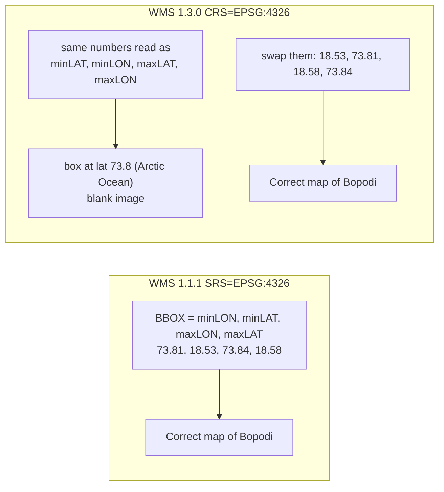
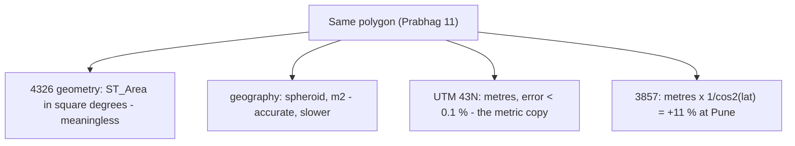

# S1 — OGC services and coordinate reference systems

*Study note in my own words. Sources: OGC WMS 1.1.1 and 1.3.0 specifications, OGC WFS 2.0, OGC API – Features Part 1, PostGIS manual chapter 4 (geometry vs geography), Fu and Sun (2011) chapter 3.*

## What the services do

| Service | Returns | Think of it as |
|---|---|---|
| **WMS** (Web Map Service) | a rendered **picture** (PNG/JPEG) of a map extent | "draw me this box" |
| **WFS** (Web Feature Service) | the **features themselves** (GML or GeoJSON) with geometry and attributes | "give me the rows" |
| **WCS** (Web Coverage Service) | the **raw raster values** (for example a GeoTIFF of elevation), not a picture | "give me the pixels" |
| **OGC API – Features** | the same idea as WFS, but as a plain REST/JSON API with pages, links and OpenAPI docs | "WFS for web developers" |

WMS answers `GetCapabilities` (what layers exist), `GetMap` (the image) and `GetFeatureInfo` (what is under this pixel). WFS 2.0 answers `GetFeature` with an optional **filter**: a CQL or XML expression such as `name IS NOT NULL AND INTERSECTS(geom, polygon)`, plus `count`/`startIndex` for paging and `numberMatched` in the reply. WCS adds `GetCoverage`, which returns actual numbers, so a client can compute slope or a profile instead of only looking at a shaded picture. OGC API – Features replaces the big XML request with URLs like `/collections/services/items?limit=50&bbox=...` and always returns GeoJSON by default. pg_featureserv implements exactly that.

## The axis-order trap (WMS 1.1.1 vs 1.3.0)

WMS 1.1.1 always treats coordinates as **x,y = longitude,latitude**, whatever the CRS says. WMS 1.3.0 changed the rule: coordinates follow the **axis order defined by the CRS authority**. EPSG:4326 is officially defined as **latitude, longitude**, so in WMS 1.3.0 a BBOX in EPSG:4326 must be written `minLat,minLon,maxLat,maxLon`. The same four numbers that work in 1.1.1 (`SRS=EPSG:4326&BBOX=73.81,18.53,73.84,18.58`) describe a box near the equator in Antarctica-sized nonsense in 1.3.0, and GeoServer returns a blank or wrongly stretched image. The parameter also changed name: `SRS` in 1.1.1, `CRS` in 1.3.0. Q4 of this project demonstrates this with two real requests.

## EPSG:4326 vs 3857 vs UTM, and why area depends on the CRS

* **EPSG:4326 (WGS 84 geographic)** stores degrees of latitude and longitude on the ellipsoid. It is a *coordinate system*, not a map projection: one degree of longitude is 111 km at the equator but only 105.6 km at Pune (latitude 18.56°, cos 18.56° = 0.948). `ST_Area` on a 4326 **geometry** therefore returns square *degrees*, a number with no physical meaning. The PostGIS **geography** type fixes this by computing on the spheroid and returning m².
* **EPSG:3857 (Web Mercator)** is what every slippy-map tile uses. It is conformal (shapes and angles are right locally) but it stretches lengths by the factor 1/cos(latitude) in both directions, so **areas are inflated by 1/cos²(lat)**. At Pune that is 1/0.948² ≈ 1.113, so every area measured in 3857 is about 11 % too big. At Oslo (60°) it is 4×.
* **UTM zone 43N (EPSG:32643)** is a transverse Mercator projection with a 6°-wide zone centred on 75°E. Inside the zone the scale error is below 0.1 %, so lengths and areas in metres are accurate enough for planning. Pune's longitude 73.83° falls in zone 43 (zone = floor((lon + 180)/6) + 1 = 43). This is why the brief wants a UTM copy of every table: `ST_DWithin(geom_utm, 500)` really means 500 metres.

**Take-away for the viva.** Pick the CRS by the question: store and exchange in 4326, draw tiles in 3857, measure in UTM or geography. My earlier PuneStay project measured straight-line distances with `ST_Distance(geom::geography, ...)`, that is on the spheroid, which is correct for distance but says nothing about the walking network. This project adds the UTM copy and the network.
