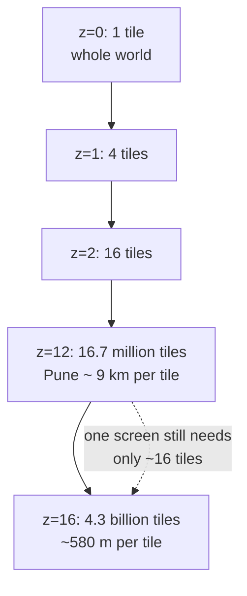
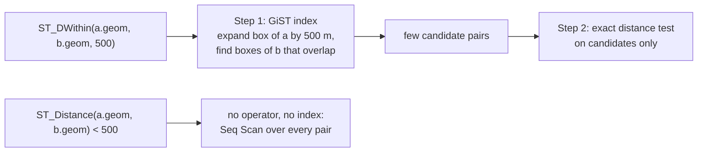

# S2 — Tiles and indexes

*Study note in my own words. Sources: OSM wiki "Slippy map tilenames", Mapbox Vector Tile specification 2.1, Protomaps PMTiles specification v3, PostGIS manual chapter 4.9 (spatial indexes), H3 documentation (h3geo.org).*

## The XYZ tile scheme and zoom levels

A web map never loads "the map"; it loads small square tiles. At zoom level **z** the world (in Web Mercator, EPSG:3857) is cut into **2^z × 2^z** tiles, each 256 or 512 pixels wide, addressed as `/{z}/{x}/{y}`. Zoom 0 is one tile for the whole world; zoom 12 is 4,096 × 4,096 tiles, and a 256-px tile covers about 9.8 km at the equator and 9.3 km at Pune; at zoom 16 a tile covers about 580 m. Each extra zoom level quadruples the tile count but each tile's area shrinks by four, so the browser always asks for roughly the same number of tiles (about 12 to 20 for one screen). That is why tiles scale to city or world size while "load everything in one GeoJSON" does not, the comparison I measure in Q9.

## Raster tiles vs vector tiles (MVT, PMTiles)

* **Raster tiles** are finished pictures (PNG/JPEG) drawn on the server. The client can only show them; it cannot restyle, query or rotate labels. A tiled WMS is a raster tile source.
* **Vector tiles** carry the *geometry and attributes* clipped to the tile and encoded compactly as protobuf, the **Mapbox Vector Tile (MVT)** format. Coordinates are integers in a 4096-unit tile grid, so a tile is small, and the client (MapLibre) draws it on the GPU with any style. Data-driven colours (for example by hex population) are a one-line style expression instead of a new server render. pg_tileserv makes MVT straight from PostGIS with `ST_AsMVT`.
* **PMTiles** is a single-file *archive* of tiles with an internal directory. A client fetches the header, then the directory, then only the byte ranges of the tiles it needs, using HTTP **Range** requests. Any static file host (GitHub Pages, S3) can therefore serve a whole tileset with no server process, which is how the public version of this map works in Phase 5.

## GiST indexes and the bounding-box pre-filter

A B-tree can sort numbers, but a point in 2-D has no single order, so PostGIS uses a **GiST** (Generalised Search Tree) index: an R-tree of nested bounding boxes. Spatial functions such as `ST_DWithin`, `ST_Intersects` and the `&&` operator are index-aware: PostGIS first compares cheap **bounding boxes** through the index, which throws away almost every row, and only then runs the exact geometry test on the few candidates. Without the index the planner has no choice but a **Seq Scan** that computes the exact distance for every pair, which is what Q2 measures. `ST_Distance(a, b) < 500` cannot use the index because `ST_Distance` is a function returning a number, not an operator the index understands; `ST_DWithin` is the index-friendly way of saying the same thing.

## H3 hexagons and resolutions

**H3** (from Uber) tiles the globe with hexagons at 16 resolutions. Resolution **8** cells average 0.74 km² (edge about 460 m); resolution **9** cells average 0.105 km² (edge about 174 m), so each step down splits a cell into roughly seven children. Hexagons are better than squares for "how far is the nearest X" questions because all six neighbours are at the same centre-to-centre distance, and each cell has a short string id (for example `88609a4b2bfffff`) that joins across tables without any geometry. In Phase 3 I aggregate population and network distance per cell at resolutions 8 and 9 and compare the two, which is exactly where the MAUP in S3 shows up.
