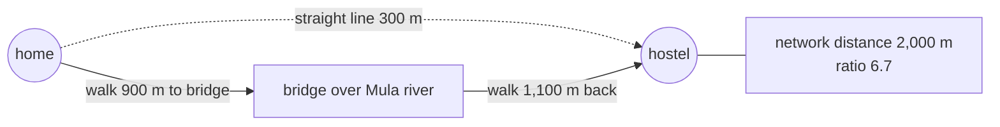
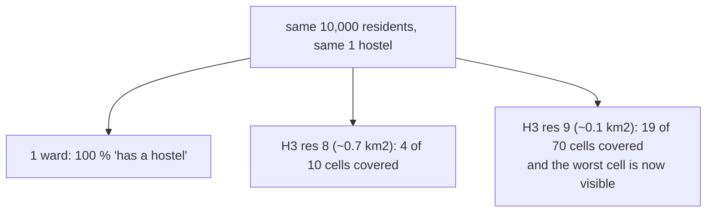

# S3 — Measuring access

*Study note in my own words. Sources: OSMnx documentation (Boeing 2017, "OSMnx: New methods for acquiring, constructing, analyzing, and visualizing complex street networks"), Openshaw (1984) on the MAUP, Peng and Tsou (2003) chapter 1, WHO/Transport for London walking-speed guidance.*

## Network distance vs straight-line distance

My earlier PuneStay project answered "what is near me?" with a **straight-line** (Euclidean or great-circle) distance: `ST_Distance(user::geography, listing::geography)`. That is what a bird flies, not what a person walks. A hostel 300 m away across the Mula river may be 2 km on foot because the nearest bridge is far. **Network distance** follows the actual streets: the OSM walking network (footways, residential roads, paths, steps; no motorways) becomes a graph where junctions are nodes and street segments are weighted edges, and Dijkstra's algorithm finds the shortest path. The ratio network/straight-line is the **detour factor**; in a grid city it is about 1.2 to 1.4, and it jumps where rivers, railways, expressways, hills or gated campuses block the way. Q6 measures that ratio for 30 random points in Bopodi and maps the worst case.

## Isochrones

An **isochrone** is the area reachable within a given travel time from a point. On a network it is built by (1) snapping the start to the nearest graph node, (2) running Dijkstra with a cut-off of *time* (or distance), (3) taking every reached node and the partially reached edges, and (4) wrapping them in a polygon, a convex hull is crude, a concave hull or buffered edges hugs the streets better. A **buffer** of the same radius is the straight-line equivalent; it always contains the isochrone and over-states coverage wherever the network is sparse. In Phase 3 I draw both around every PG/hostel and compare the population inside each.

## Walking-speed assumptions

Distance becomes time only through an assumed speed. The brief uses **4.8 km/h** (80 m/min), a typical healthy-adult pace, so 15 minutes is 1,200 m along the network. For an urban ward like Prabhag 11 a 15-minute threshold is the standard "15-minute city" test; for a rural taluka the brief allows 30 minutes (2.4 km). Elderly people, children and people with luggage walk closer to **3.6 km/h** (60 m/min), which shrinks 15 minutes to 900 m, and Q8 shows how many residents drop out of coverage when the model is built for them instead of for a fit adult. Speed also hides other assumptions: it ignores waiting at crossings, slopes (the DEM would let me correct for that), heat, and whether a footpath actually exists.

## The modifiable areal unit problem (MAUP)

When point data are summarised by areas, the result depends on **how the areas are drawn**, not only on the data. Two effects: the **scale effect** (coarser units smooth away pockets of poor access, finer units expose them) and the **zoning effect** (shifting boundaries while keeping the same size changes which people fall in which unit). A ward average may say "90 % covered" while resolution-9 hexagons show a whole neighbourhood at 0 %. There is no "correct" unit; the honest answer is to report more than one, which is why Q7 computes the uncovered share by ward, by H3 resolution 8 and by H3 resolution 9 and checks whether the conclusion changes. Hexagons reduce, but do not remove, the problem: they are at least equal in size and shape, so the zoning effect is smaller than with irregular wards.

