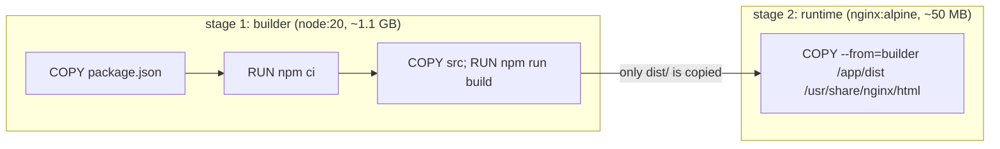
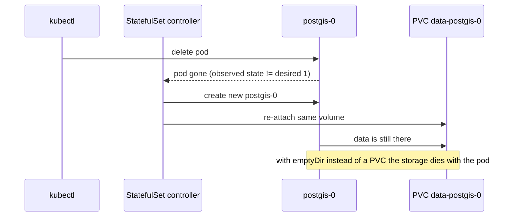

# S4 — Docker and Kubernetes

*Study note in my own words. Sources: Docker docs "Get started" and "Multi-stage builds", Docker Compose specification, Kubernetes docs "Concepts" (Pods, Deployments, StatefulSets, Services, Secrets, Persistent Volumes), kind quick start.*

## Image vs container, layers, multi-stage builds, Compose

* An **image** is a read-only, layered file system plus metadata (which command to run, which port to expose). A **container** is a running (or stopped) *instance* of an image with one thin writable layer on top. One image, many containers, like a class and its objects.
* A **Dockerfile** builds an image line by line; every `RUN`, `COPY` or `ADD` creates a **layer**. Layers are cached and shared: if only my client's HTML changes, only the last `COPY` layer is rebuilt. `docker history` lists the layers with their sizes, which Q10 uses to find the largest one.
* A **multi-stage build** uses two `FROM` lines: a fat *builder* stage with Node and all build tools, and a slim *runtime* stage (nginx:alpine) that only copies the finished `dist/` folder out of the builder. The toolchain never reaches the final image, so it shrinks from hundreds of MB to tens of MB and has a smaller attack surface.
* **Compose** describes several containers in one YAML file on one private network. Each service's name is a DNS name inside that network, so GeoServer connects to `db:5432`, never `localhost`, because inside a container `localhost` is the container itself. Named **volumes** keep data outside the container's writable layer so `docker compose down` does not delete the database.

## Kubernetes objects

| Object | What it is | In this project |
|---|---|---|
| **Pod** | the smallest unit: one or more containers sharing a network namespace and storage; disposable | one PostGIS pod, one client pod |
| **Deployment** | keeps *N identical, interchangeable* pods running; replaces a dead pod with a new one that has a new name and a fresh file system | the nginx map client |
| **StatefulSet** | keeps pods that have a *stable identity*: fixed name (`postgis-0`), stable network name, and **its own persistent volume that follows the pod** when it is recreated | PostGIS |
| **Service** | a stable virtual IP and DNS name in front of pods, since pod IPs change | `postgis` on 5432, `client` on 80 |
| **Secret** | key-value data (passwords) stored separately from the manifests and injected as env vars or files | `POSTGRES_PASSWORD` |
| **PersistentVolumeClaim (PVC)** | a request for storage that outlives any pod; bound to a PersistentVolume | the database directory |

## Self-healing, and why a database needs persistent storage

Kubernetes is a **reconciliation loop**: I declare "one PostGIS pod must exist", and a controller keeps comparing the real state with that declaration. If I `kubectl delete pod postgis-0`, the StatefulSet notices the gap and starts a replacement within seconds (Q11 times this with `kubectl get pods -w`). Self-healing only helps a database if the *data* survives the pod. A pod's own file system (and an `emptyDir` volume) is deleted with the pod, so a database on `emptyDir` comes back empty, which is what Q11 shows in its second run. With a **PVC** the volume is detached from the dead pod and re-attached to the new one, and the data is still there. That is also why a database is a **StatefulSet, not a Deployment**: a Deployment's pods are interchangeable and could even run two copies writing to the same files during a rollout, while a StatefulSet guarantees ordered, one-at-a-time replacement and a one-to-one bond between `postgis-0` and its volume.

